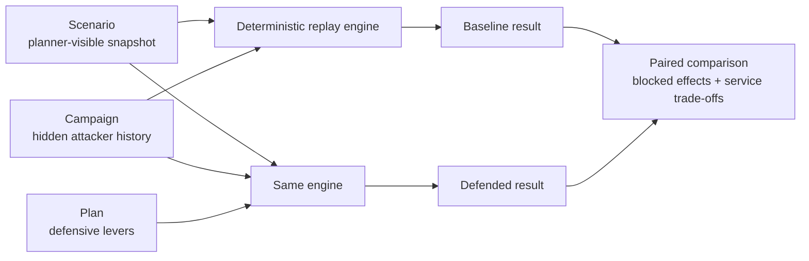
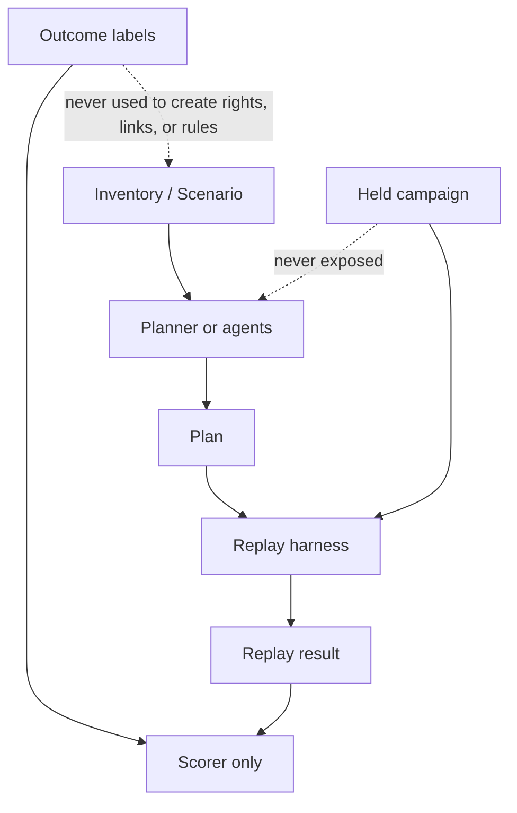
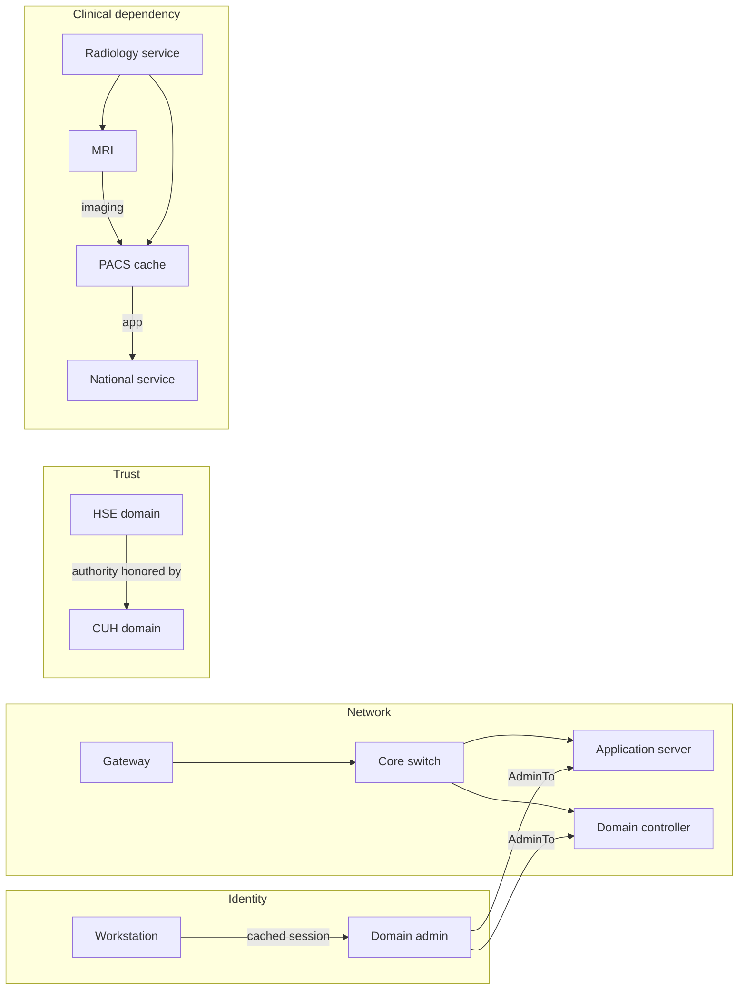
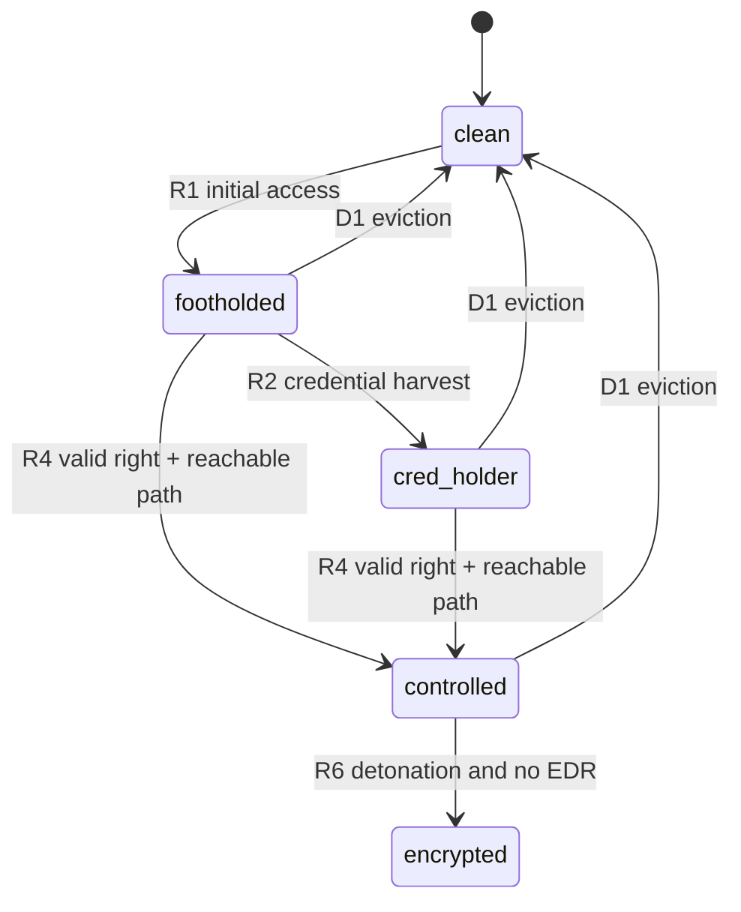
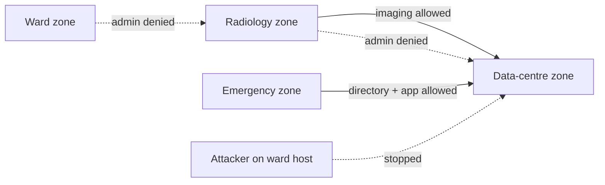
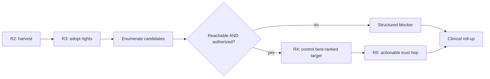
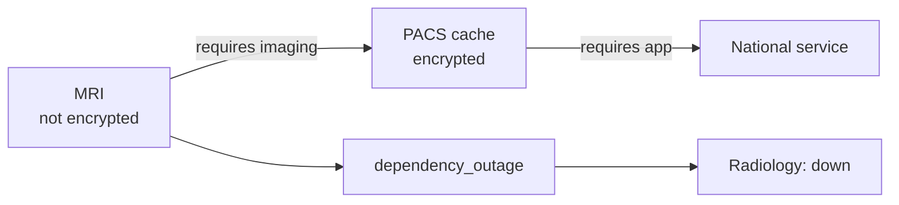
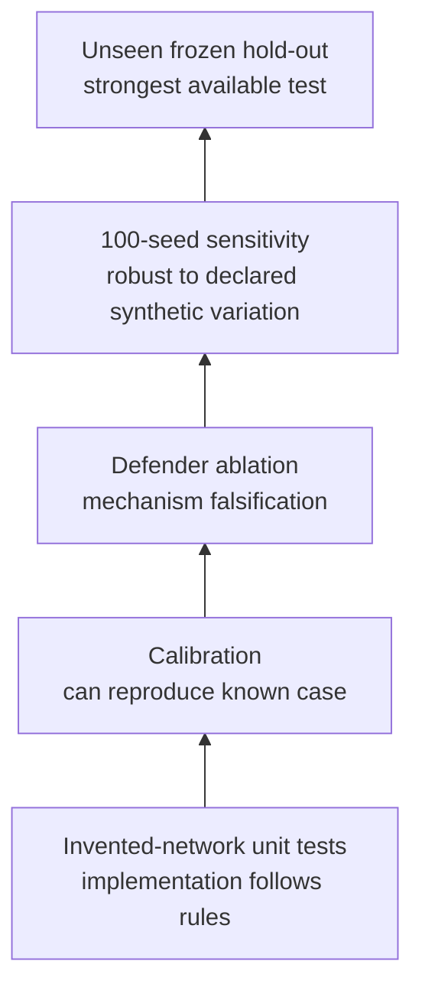

# A Causal Replay Engine for Hospital Ransomware Segmentation

## A paper-style guide, exhibit book, and explanation script

This document explains the standalone Python backtest in `engine/sim_core` as if
it were a research paper. It is written for someone who needs to understand the
model well enough to explain it, defend its choices, and point to a concrete
artifact for every claim.

The shortest accurate description is:

> The engine replays an abstract ransomware campaign over four linked graphs—
> network, identity, domain trust, and clinical dependency—and asks whether a
> proposed defense removes the exact prerequisites the campaign needs while
> preserving the flows hospital services need.

It never runs malware, exploits a host, or predicts patient injury. ATT&CK names
are labels on deterministic state transitions.

---

## Abstract

Flat-network epidemic models treat every reachable computer as equally likely to
infect every other computer. That is a poor model of a human-operated ransomware
campaign: the attacker also needs credentials, administrative authority, domain
trust, a usable route, and time. Hospital impact introduces another graph because
a medical device may remain uncompromised while becoming unusable when its server
or national service disappears.

This engine represents those mechanisms as a deterministic state-transition
system. It separates the pre-incident hospital snapshot, the hidden campaign, and
the proposed plan. Lateral movement occurs only when network reachability **and**
identity authority both hold. Clinical availability is derived from transitive
dependencies after every step. The same authored campaign is replayed before and
after a plan, then rerun with individual defenses removed to study causal
necessity. Synthetic-interior perturbations test sensitivity; freeze manifests
and a one-use ledger limit leakage from held-out outcomes.

The current Cork reconstruction is exploratory. Under its disclosed assumptions,
14 IT hosts encrypt without a local plan and zero encrypt with the full example
plan. Radiology and email still fail after the national network disconnection,
showing that local cyber containment and clinical continuity are separate results.
These numbers demonstrate the model; they are not a calibrated estimate of the
real Cork incident.

---

## 1. What problem is the engine answering?

The research question is:

> If the same attacker campaign meets the same hospital before and after a
> segmentation plan, which attack transitions are prevented, which clinical
> workflows remain available, and which failures lie outside the local plan?

Three subsidiary questions make that test meaningful:

1. **Mechanism:** Was spread stopped because a real prerequisite failed, such as
   loss of reachability or loss of administrative authority?
2. **Trade-off:** Did the plan itself remove a flow required by a clinical service?
3. **Robustness:** Does the conclusion survive reasonable changes to the synthetic
   interior, or depend on one convenient placement of credentials and old hosts?

The model is deliberately closer to a causal replay than a forecast. It asks
“what follows from these declared facts and assumptions?” It does not estimate
“what is the probability this hospital will be attacked next year?”

### Exhibit 1 — The experimental design



How to explain this exhibit:

> We do not generate a new attack to flatter the plan. We replay the same hidden
> campaign against the original and modified snapshots. The difference is the
> plan, so changed transitions can be inspected directly.

---

## 2. System boundary: there are two engines in the repository

This distinction prevents an easy but serious explanation error.

| Component | Purpose | Mathematical character | Used for |
|---|---|---|---|
| `packages/sim-core` | Live visual demonstration | Seeded probabilistic infection over application flows | Animated SpacetimeDB/product runs and patient-group UI states |
| `engine/sim_core` | Historical causal backtest | Deterministic rule replay over network, identity, trust, and dependency graphs | Research checks, plan comparison, sensitivity, audit traces |

The TypeScript demo engine uses illustrative per-protocol probabilities. The
Python backtest does not. The Python engine is the subject of this paper. It is
not wired into the visible simulation and does not calculate patient outcomes.
The browser replay screen is a render-only view of Python results.

How to explain this aspect:

> One model makes the hackathon demonstration move; the other tests a historical
> causal claim. Keeping them separate stops visual probabilities from being
> mistaken for incident evidence.

---

## 3. Inputs, information boundaries, and provenance

The core accepts three strict objects:

- **Scenario:** nodes, host profiles, physical links, domains, trusts, accounts,
  services, clinical dependencies, and defenses that are available.
- **Campaign:** initial attacker context, ordered events, alternative entry routes,
  target intent, and a bounded number of host-level steps.
- **Plan:** the permitted defensive levers and segmentation allow-flows.

The planner may read the scenario. It may not read the campaign, ground truth,
or outcome labels. Pydantic rejects extra fields so an embedded `expected` or
`campaign` block cannot quietly cross the planner boundary.

Every reconstructed fact carries a provenance category:

| Tag | Meaning | Example |
|---|---|---|
| `R` | Reported in an incident review | National disconnection at 05:10 |
| `P` | Publicly reported outcome | A service was cancelled or continued on paper |
| `I` | Inferred from evidence | Prior possession of an external privileged credential |
| `S` | Synthetic reconstruction | Which exact workstation cached a given account |
| `X` | Redacted or deliberately unknown | Product identity, exploit detail, patient zero identity |

### Exhibit 2 — The leakage barrier



The engine has a strict CUH inventory adapter. It also has an evidence audit that
refuses to complete the national HSE and British Library inputs from their desired
outcomes. For example, the national file has no host-level account/session data;
the British Library file lacks the network links and entitlements needed to earn
all of its reported server outcomes. Those checks are therefore reported as
`unsupported`, not forced to pass.

---

## 4. The formal model

Let:

- \(V_H\) be hosts and external service nodes;
- \(V_A\) be accounts;
- \(V_D\) be domains;
- \(V_S\) be services;
- \(G_N\) be the network graph;
- \(G_I\) be the identity graph;
- \(G_T\) be the directed domain-trust graph;
- \(G_C\) be the clinical-dependency graph.

All four layers are stored in one namespaced `networkx.MultiDiGraph`. Namespacing
matters: a host called `CUH` cannot collide with a domain or account called `CUH`.
An edge from the identity or dependency layer can never become a physical network
shortcut because network reachability traverses `network` edges only.

### Exhibit 3 — Four layers, one hospital



| Layer | Question answered | Source idea |
|---|---|---|
| Network | Can traffic of this functional class travel from A to B? | Network segmentation and zone models |
| Identity | Does a possessed account have declared authority over B? | BloodHound/OpenGraph |
| Trust | Will domain B honor a principal from domain A? | AD trust analysis / BloodHound |
| Dependency | If B fails or a required flow is cut, what service loses function? | Hospital resilience literature |

The graph is not itself the simulation. Rules query it to decide whether a state
transition is legal.

---

## 5. State: what changes during a replay?

Each node has one monotone attacker level:

```text
clean < footholded < cred_holder < controlled < encrypted
```

Defender actions are the only operations that can lower or fence that state.

| State | Precise meaning |
|---|---|
| `clean` | No declared attacker execution or control |
| `footholded` | The attacker has execution on the node |
| `cred_holder` | Credentials cached on that executing node have been inspected |
| `controlled` | The attacker has exercised valid administrative authority over it |
| `encrypted` | A controlled, encryptable, unprotected IT host was affected at detonation |

The attacker separately holds:

- a set of acquired credentials;
- a set of credentials adopted for their administrative grants;
- a set of domains whose cross-domain grants can be exercised.

Nodes also carry defense flags such as EDR, blocking AV, patched, and evicted.
Services do not have independent attacker state; `up`, `paper`, and `down` are
derived from dependencies after each event.

### Exhibit 4 — State machine



Two subtle design choices repair dead ends in a literal reading of the draft:

1. A foothold may originate authenticated remote movement. Requiring a
   `controlled` source would make R1 → R2 → R3 unable to reach the first R4.
2. Credentials are sets of rights, not a single power score. A same-tier account
   can be useful because it administers different machines. R3 therefore retains
   every acquired account with an explicit administrative grant.

---

## 6. The transition rules

Every rule has preconditions, an effect, an ATT&CK label, and a structured trace
entry. A failed precondition produces a blocker; it does not silently disappear.

| Rule | Meaning | Essential precondition | Effect | ATT&CK label |
|---|---|---|---|---|
| R1 | Initial access | Declared entry mode fits the target; endpoint protection does not block it | Target becomes footholded | T1566 / T1190 / T1078 |
| R2 | Credential harvest | Active execution on eligible Windows IT; no blocking protection | Collect only accounts with sessions on that host | T1003 |
| R3 | Adopt credentials | Acquired account has explicit administrative grants | Account becomes usable; no host is compromised | T1078 |
| R4 | Lateral movement | Executing source, network reach, valid account grant, target eligible | Target becomes controlled | T1021 |
| R5 | Trust hop | Directed trust, source-domain privileged credential, explicit cross-domain grant, reachable target-domain host | Target domain becomes exercisable | T1199 |
| R6 | Detonation | Authored trigger; host controlled, encryptable, and without EDR | Host becomes encrypted | T1486 |
| D1 | Evict and reset | Explicit organization and unambiguous account ownership | Hosts clean/fenced; org credentials invalidated everywhere | Defender action |
| D2 | Endpoint protection | Explicit organization and deterministic coverage cohort | EDR/AV blocks later execution and encryption | Defender action |
| D3 | Disconnect | Explicit physical network links | Paths are removed; dependency loss may follow | Defender action |

### Exhibit 5 — The core causal equation

For a target host \(x\), R4 is legal only if:

\[
\exists u \in \text{ExecutingHosts}:\
Reach_{admin}(u,x)
\land
\exists a \in \text{UsableCredentials}:\
Authorized(a,x)
\land
\neg Evicted(x)
\]

The network term is:

\[
Reach_p(u,x) = PhysicalPath_p(u,x) \land ZoneAllows_p(u,x)
\]

The identity term requires a declared host grant, a same-domain wildcard, or an
explicit `*@TargetDomain` grant whose directed trust hop has succeeded.

How to explain this exhibit:

> A flat cable path is insufficient. A powerful password is also insufficient if
> the network wall blocks the administrative flow. Ransomware movement occurs
> only at the intersection of topology and authority.

This is the central difference from SIR or “encrypt everything reachable.”

---

## 7. Segmentation and clinical allow-flows

A plan divides departments into zones. Cross-zone traffic is denied unless a
directed functional allow-flow exists:

```text
(source zone, destination zone, port class)
```

Examples are `rad → dc → imaging`, `rt → dc → oncology`, and
`ed → dc → directory`. These are semantic service classes, not exploit ports.
Switches remain transit nodes; an allow-flow is checked against the original
endpoints so routing through a permitted switch cannot create a new permission.

Unlisted departments become isolated singleton zones. The reserved `unlisted:`
namespace prevents them from colliding with an explicitly named zone.

### Exhibit 6 — Security and clinical traffic use the same wall



The friction is intentional. A plan that removes a necessary imaging or directory
flow causes a pre-attack service outage. The engine exports that separately as
`plan_induced_service_loss`; it cannot be presented as successful containment.

---

## 8. The attacker is adaptive but bounded

Historical events name only some steps. Within a hospital, the attacker chooses
targets rather than following a completely fixed host list.

The default goals are:

- encryptable hosts listed in each service's `requires_all`; and
- domain controllers.

For each microstep the engine:

1. harvests credentials on newly executing eligible hosts;
2. adopts every newly useful administrative account;
3. finds legal lateral-movement candidates;
4. ranks them by distance to an unmet goal;
5. breaks ties by `(distance, domain, department, node_id)`;
6. performs at most one lateral movement;
7. exercises any newly actionable trust hop;
8. recomputes clinical availability.

The heuristic graph contains cached-credential paths, dependency paths, and
network pivots that are possible with currently usable rights. It ranks legal
options but never grants permission. That distinction prevents a shortest-path
calculation from becoming an accidental exploit.

Alternative doors are explicit campaign inputs. A failed gateway may lead to an
authored HSE-trust route, but the model will not invent a vendor compromise from
a node merely named “vendor.” A detour budget bounds these attempts.

### Exhibit 7 — One deterministic tick



No random number is used on this replay path. The only RNG is in the separate
synthetic-interior sensitivity generator.

---

## 9. Clinical dependency and service state

A medical device is not treated as an ordinary Windows endpoint simply because
its embedded profile says Windows. The top-level `medical_device` identity wins:
medical devices never encrypt in this model. They may become unavailable because
their server, directory, application, or national dependency fails.

For every host \(h\), let \(Cause(h)\) begin with:

- `encrypted:h` when the host is encrypted;
- `flow_cut:h→provider:class` when a required functional path is missing; or
- `disconnected:h` for an unreachable external dependency.

Then propagate causes to a fixed point:

\[
Cause(h) \leftarrow Cause(h) \cup
\bigcup_{d \in Requires(h)} Cause(d)
\]

For a service \(s\):

\[
State(s) =
\begin{cases}
up & \text{if all required assets and consumers have no causes}\\
paper & \text{if a cause exists and paper fallback is declared}\\
down & \text{if a cause exists and no paper fallback exists}
\end{cases}
\]

### Exhibit 8 — A device can be clean while its service is down



A merely controlled server does not degrade service. This encodes the historical
observation that services can continue during attacker dwell time and fail at
detonation or disconnection.

---

## 10. The seven plan levers

| Lever | Fact changed in the model | What it cannot claim |
|---|---|---|
| `segment_departments` | Cross-zone reachability, subject to clinical allow-flows | It does not remove account rights |
| `cut_hse_trust` | External↔internal domain authority edges | It does not disconnect national clinical services |
| `tier_admin_accounts` | Removes Tier-0 cached sessions from non-DC hosts | It does not delete all administrator accounts |
| `patch_gateway` | Marks eligible non-EOL remote gateway patched | It cannot repair an EOL gateway |
| `mfa_remote` | Blocks stolen-credential remote login | It does not stop an unauthenticated edge exploit |
| `edr_servers` | Adds blocking EDR to encryptable IT servers | It does not encrypt/protect medical devices by relabeling them |
| `offline_backup` | Removes the backup store from attack access/corruption | It does not invent a recovery time or keep live services up |

A trace credits a lever only when the plan actually changed the blocking fact.
Preexisting EDR or MFA receives no plan credit.

---

## 11. Historical time and determinism

The campaign clock is authored rather than inferred from desired outcomes.
Events have a timestamp and explicit order. Mixed date-only and timed events on
the same day are rejected because sorting them would invent chronology. A dated
idle interval fires no rules. A host-level `tick` event has an explicit microstep
budget; reaching the budget produces an observation rather than unlimited spread.

The replay output is deterministic because:

- candidates and hosts are sorted with total ordering;
- the core reads no wall clock;
- the core uses no replay RNG;
- the scenario, campaign, plan, and rules version are hashed into a cache key;
- CLI, direct Python, cache, HTTP, and WebSocket paths serialize the same result;
- cross-process tests vary `PYTHONHASHSEED` and still require byte identity.

### Exhibit 9 — Reproducibility identity

```text
cache_key = SHA256(canonical_json({
  scenario,
  campaign,
  plan,
  rules_version
}))
```

An offline attack bundle stores the canonical inputs and expected result digest.
Verification reruns the frozen inputs and rejects a modified bundle.

---

## 12. What the output contains

The output has four complementary views:

| Output | What it answers |
|---|---|
| `trace[]` | Which rule applied or failed, on which node, through which source/account, and why? |
| `services[]` | At every event, which services were up, on paper, or down, and what caused it? |
| `event_effects[]` | Which levels, credentials, privileges, and domains changed during each authored event? |
| `summary` | Final encrypted hosts, targeted organizations, service outcomes, blocker list, assumptions, and backup/device facts |

A failed R1 under the full Cork example produces blockers such as:

```text
R1 GW-REMOTE: patched_edge [credited to patch_gateway]
R5 CUH: no_trust [credited to cut_hse_trust]
        + unreachable_domain [no lever credit]
```

The second blocker is important: removing trust is insufficient unless the
remaining execution and network context is also understood.

---

## 13. Counterfactual attribution

The main comparison runs:

1. baseline with no plan;
2. full plan;
3. full plan with each lever removed in turn.

An avoided encrypted host is attributed to a lever only when removing that lever
from the full plan restores the host's encryption. This is **necessity in the
context of the other levers**, not a Shapley value and not proof that the lever is
universally sufficient.

### Exhibit 10 — Why empty leave-one-out credit can be correct

In the current Cork example:

| Configuration | Encrypted IT hosts | Interpretation |
|---|---:|---|
| No plan | 14 | Authored campaign reaches its goals |
| Full seven-lever plan | 0 | Multiple barriers prevent the campaign |
| Segmentation only | 0 | This particular authored campaign is contained by the wall |
| EDR on servers only | 6 | Server encryption is reduced, but workstation/service goals remain affected |
| Cut trust only | 14 | Gateway route remains |
| Tier accounts only | 14 | Alternate rights/path remain sufficient |
| Patch gateway only | 14 | Authored trust alternative remains |
| MFA only | 14 | The gateway event is an edge exploit, not stolen-credential login |
| Offline backup only | 14 | Recovery protection does not stop live propagation |

The full plan's leave-one-out attribution is empty for every single lever. That is
not a contradiction. The plan contains redundant barriers: removing one defense
still leaves another defense capable of stopping the campaign. The single-lever
table tests sufficiency; leave-one-out tests necessity within the combined plan.
Both are required to explain defense in depth honestly.

How to explain this aspect:

> “Only segmentation works” is a statement about this authored reconstruction,
> not a universal ranking. “No lever is individually necessary in the full plan”
> means the full plan has redundancy. Those are different counterfactuals.

---

## 14. Research evaluation strategy

The engine uses several tests because no single comparison establishes validity.

### 14.1 Calibration

The intended HSE calibration checks spread order, encrypted organizations,
survivors, privilege acquisition, dormancy, and service loss. Organization
outcomes are scored only among organizations the campaign targeted. Untouched
organizations are not counted as successful negatives.

Current status: the supplied national snapshot lacks host/account/session detail,
so the implementation reports this check as unsupported rather than manufacturing
33 privileged accounts from the calibration target.

### 14.2 Defender ablations

Remove D1 or D2 from the campaign and ask whether the corresponding survivor
changes outcome. This tests “right answer for the right mechanism.” The ablation
must remove an actual authored defender event; a nonexistent event is an error.

### 14.3 Weak baselines

Two deliberately weaker controls are included:

- encrypt every reachable host;
- deterministic SIR over the reachability graph.

Both discard credential authority and effective defender actions. They are used
to demonstrate why network-only propagation cannot explain survivor cases, not as
realistic epidemiological estimates.

### 14.4 Synthetic-interior sensitivity

Only the generator uses randomness. For a fixed seed it perturbs:

- which eligible workstations are old/EOL;
- cached-session placement within existing organizational/domain footprints; and
- optionally, extra non-administrative clinical allow-flows.

It preserves medical flags, hardware, domain membership, account tiers, and
administrative grants. Results are reported as “share of declared synthetic seeds
matching an outcome,” not as a probability about the real hospital.

The EOL denominator is explicit: nonmedical Windows `ws`, `cow`, and `console`
nodes. This avoids silently mixing the 95 total nodes, 75 Windows nodes, and 46
Windows-7 profiles into one percentage.

### 14.5 Hold-outs and leakage control

A freeze manifest hashes code, data, campaign, plan, generator, and scoring
protocol before an evaluation. A one-use ledger claims the attempt before labels
are evaluated; failed attempts are consumed. Re-freezing under the same study ID
does not reset the claim.

The supplied Cork and British Library outcomes were inspected during development.
They can only be described as exploratory. A genuine unseen claim requires a new
frozen scenario whose labels were not inspected before the rules and generator
were committed.

### Exhibit 11 — Strength of evidence ladder



Passing a lower level does not imply passing a higher one. The current engine has
strong mechanism tests and exploratory CUH results; national and British Library
validation remain unsupported with the supplied causal inputs.

---

## 15. Current Cork demonstration result

The strict adapter loads 95 nodes and 97 network links. The example campaign
declares—not discovers—an unpatched-gateway attempt, a bounded 100-microstep
window, prior possession of one HSE credential, one alternative trust route,
detonation at 01:00, and the 05:10 national disconnection.

### Exhibit 12 — Before and after

| Outcome | No local plan | Full illustrative plan |
|---|---:|---:|
| Encrypted IT hosts | 14 | 0 |
| Encrypted medical devices | 0 | 0 |
| Services initially disrupted by plan | 0 | 0 |
| Services down after national cut | Radiology, radiotherapy, laboratory, email | Radiology, email |
| Services on paper after national cut | ED, theatres, outpatients/chemotherapy, pharmacy | ED, theatres, outpatients/chemotherapy |
| Services remaining up after national cut | none of the eight modeled services | Radiotherapy, laboratory, pharmacy |

The 14 baseline encrypted hosts are:

```text
APP-01, CITRIX-01, DC-01, DC-02, LIS-01, NIMIS-1, OIS-01,
PACS-CACHE, TPS-SRV, WS-ADM-4, WS-ED-1, WS-LAB-1, WS-PH-1,
WS-THR-1
```

The result contains two separate lessons:

1. The local layered plan prevents encryption in this reconstruction.
2. Local containment cannot prevent a dependency outage caused by the national
   HSE/NHN cut, so radiology and email still fail.

This separation is the clinical contribution of the model. “No local encryption”
does not mean “all care continues.”

---

## 16. What is novel, and what is borrowed?

The engine's individual ingredients are established:

| Source tradition | Idea used | Idea deliberately excluded |
|---|---|---|
| BloodHound/OpenGraph | `AdminTo`, cached sessions, domain membership, trust | Static map as a complete incident explanation |
| MulVAL | Preconditions and effects | Vulnerability-scan pipeline and unbounded logical state expansion |
| Meta Attack Language | AND/OR attack and defense steps | Probabilistic time-to-compromise |
| CyberBattleSim | Host facts, cached credentials, effects | Reinforcement-learning environment and toy-network objective |
| CybORG/CAGE | Zones and availability scoring | Dec-POMDP machinery |
| MITRE ATT&CK / Attack Flow | Technique labels and sequence vocabulary | Executable attack instructions |
| Hospital resilience papers | IT loss propagates into workflow degradation | Claims that dependency mapping predicts clinical harm |
| SIR/percolation | Weak baseline and explanatory contrast | Main propagation mechanism |

The contribution is their join:

> identity-aware, trust-aware attack replay + network segmentation + transitive
> clinical dependency + paired counterfactual evaluation + explicit leakage
> controls.

The novelty claim should be modest. This is a research prototype that combines
mechanisms in a useful way; it is not evidence that the mechanisms were invented
here or that the model has been statistically validated.

---

## 17. Threats to validity

### Construct validity

- `controlled` and `encrypted` are abstractions, not forensic proof of a technique.
- Functional classes such as `imaging` and `oncology` are reconstructed, not
  packet-level measurements.
- A service's paper fallback is coarse; it does not measure delay severity.

### Internal validity

- The example campaign includes authored times and prior attacker context.
- A wrong account session or dependency edge can change the causal path.
- Leave-one-out attribution measures necessity in one plan context, not universal
  policy value.

### External validity

- CUH's 95-node interior is synthetic.
- One national campaign and a small number of public survivor cases cannot support
  statistical generalization.
- HSE and British Library inputs are currently too incomplete for honest full
  validation.

### Reproducibility limitations

- Deterministic output guarantees that declared inputs replay identically; it
  does not guarantee that those inputs are true.
- The one-use ledger discourages accidental leakage but is not tamperproof against
  someone deleting their own research history.

### Safety and scope

- No exploit implementation, malware execution, command sequence, or real-network
  action exists in the engine.
- No field identifies a patient.
- The backtest derives service availability only; it does not calculate injuries,
  deaths, or mortality.

---

## 18. How to explain every aspect aloud

| If asked about… | Say this | Point to |
|---|---|---|
| The core idea | “It is a deterministic replay of prerequisites, not a malware emulator.” | Exhibits 1 and 5 |
| Why four graphs | “Network access, credential authority, domain trust, and clinical dependency answer different questions.” | Exhibit 3 |
| Why not SIR | “Reachability alone cannot represent credentials, trusts, or targeted defender actions.” | Section 14.3 |
| Lateral movement | “A usable path and a usable administrative identity must both exist.” | Exhibit 5 |
| Trust | “Trust allows an existing explicit cross-domain grant; it never creates a credential.” | R5 in Section 6 |
| Medical devices | “They never encrypt in this model, but their dependencies can fail.” | Exhibit 8 |
| Segmentation trade-off | “The same wall that stops admin traffic can break imaging, so required flows are explicit and checked before attack.” | Exhibit 6 |
| Adaptive attacker | “It chooses the closest legal route to a service/DC goal but cannot use the heuristic to bypass a rule.” | Exhibit 7 |
| Determinism | “Same scenario, campaign, plan, and rules version produce the same bytes and cache key.” | Exhibit 9 |
| Causal credit | “We compare baseline, full plan, and plan-minus-one-lever; blockers and outcomes are separate evidence.” | Exhibit 10 |
| Robustness | “We vary only declared synthetic facts and report a sensitivity share, not a real probability.” | Section 14.4 |
| Validation | “Known cases calibrate; ablations falsify mechanisms; only a frozen unseen case can be called a hold-out.” | Exhibit 11 |
| Current evidence | “CUH is exploratory; national HSE and BL remain unsupported where causal inputs are missing.” | Sections 14 and 17 |
| Clinical conclusion | “Preventing local encryption cannot prevent every national dependency outage.” | Exhibit 12 |

---

## 19. Three explanation lengths

### 20 seconds

> We model ransomware as state transitions across network, identity, trust, and
> clinical-dependency graphs. The attacker can move only when a route and valid
> administrative authority both exist. We replay the same campaign before and
> after a plan, then show exactly which step failed and which services still lose
> dependencies.

### 90 seconds

> Ordinary infection models say anything reachable can be infected. Human-run
> ransomware is different: the operator needs execution, cached credentials,
> admin rights, domain trust, and a network path. Our engine models each as an
> explicit precondition. It then derives hospital service state from dependencies,
> so a scanner can remain clean while radiology goes down because PACS or the
> national network disappeared. We run an authored campaign against the original
> hospital and the same hospital with a plan. Every applied or blocked transition
> is logged. We also remove individual defenses, compare against deliberately
> weak network-only baselines, perturb the synthetic interior over fixed seeds,
> and freeze evaluation inputs to reduce leakage. In the exploratory Cork model,
> the full plan changes 14 encrypted IT hosts to zero, but radiology and email
> still fail after the national cut. That demonstrates the distinction between
> local containment and clinical continuity.

### Five-minute structure

1. State the research question and show Exhibit 1.
2. Explain the four graphs with Exhibit 3.
3. Spend most time on the AND condition in Exhibit 5.
4. Show why medical devices and services require Exhibit 8.
5. Explain defense-in-depth using the two counterfactuals in Exhibit 10.
6. Present the Cork result in Exhibit 12 with the word “exploratory.”
7. End with Exhibit 11 and the evidence limits.

---

## 20. Reproducing the artifacts

From `engine/`:

```sh
uv sync --python 3.11 --group dev
uv run pytest -q

uv run hippo-backtest replay \
  --scenario ../claude_instructions/data/scenarios/cuh_hospital.json \
  --campaign examples/cuh_campaign.json

uv run hippo-backtest replay \
  --scenario ../claude_instructions/data/scenarios/cuh_hospital.json \
  --campaign examples/cuh_campaign.json \
  --plan examples/cuh_plan.json --compare

uv run hippo-backtest sensitivity \
  --scenario ../claude_instructions/data/scenarios/cuh_hospital.json \
  --seed 17
```

The browser exhibit is available at `/replay` after running the web app. Its
offline data is in `apps/web/public/propagation-runs/`; `index.json` contains the
same before/after and single-lever summaries used in Exhibit 10.

The verified test result when this guide was written was **113 passing tests**.
One dependency deprecation warning from Starlette/AnyIO was present; it does not
change replay results.

---

## References and implementation artifacts

### Research and incident sources

- PwC, *Conti Cyber Attack on the HSE: Independent Post Incident Review* (2021).
- Ou, Govindavajhala, and Appel, MulVAL, USENIX Security (2005).
- BloodHound OpenGraph documentation.
- Meta Attack Language / coreLang and MAL Simulator.
- Microsoft CyberBattleSim.
- CybORG / CAGE Challenge 4.
- MITRE ATT&CK and MITRE CTID Attack Flow v3.
- Ghayoomi et al., *Assessing resilience of hospitals to cyberattack*,
  *Digital Health* (2021), DOI 10.1177/20552076211059366.
- Willing et al., *Simulating the overload of medical processes due to system
  failures during a cyberattack*, *BMC Medical Informatics and Decision Making*
  (2025).
- British Library, *Learning lessons from the cyber-attack* (2024).
- Public Cork hospital reporting listed in `claude_instructions/SOURCES.md`.

### Code and data map

| Artifact | Role |
|---|---|
| `sim_core/schema.py` | Strict model definitions and reference validation |
| `sim_core/topology.py` | Four graph layers, reachability, authority, and goal distance |
| `sim_core/engine.py` | R1–R6, D1–D3, adaptive tick, and clinical roll-up |
| `sim_core/replay.py` | Authored scheduling, deterministic result, paired comparison |
| `sim_core/generator.py` | Seeded synthetic-interior sensitivity |
| `sim_core/research.py` | Baselines, ablations, robustness, freeze, one-use ledger |
| `sim_core/protocols.py` | Fixed outcome/scoring mappings |
| `sim_core/adapters.py` | Strict CUH reconstruction and evidence-gap audit |
| `examples/cuh_campaign.json` | Disclosed exploratory attacker reconstruction |
| `examples/cuh_plan.json` | Disclosed illustrative defense plan |
| `tests/` | Mechanism, transport, determinism, leakage, and protocol tests |
| `RESEARCH_DECISIONS.md` | Detailed rationale and evidence ledger |
| `../claude_instructions/SOURCES.md` | Full source list |

